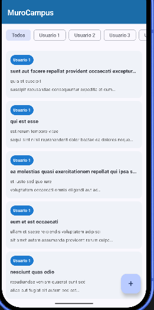
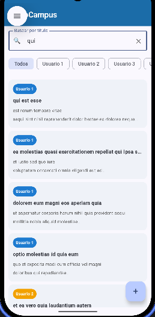
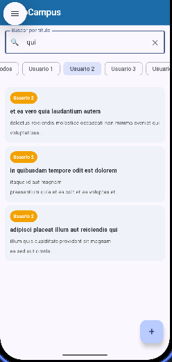
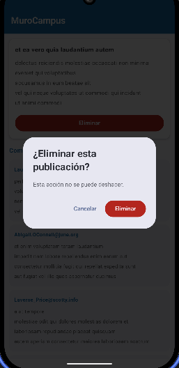
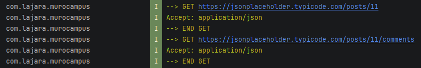

# MuroCampus

## Descripción

MuroCampus es una aplicación Android hecha con Kotlin y Jetpack Compose que consume el servicio web REST de prueba JSONPlaceholder. Permite listar publicaciones, ver el detalle de una publicación con sus comentarios, filtrar por usuario y crear una publicación nueva. También maneja los errores de red mostrando un mensaje y un botón para reintentar.

Usa Retrofit con OkHttp para las llamadas, kotlinx.serialization para convertir el JSON en `data class`, y una arquitectura MVVM con Repository.

## Estructura de paquetes

```text
com.lajara.murocampus/
├── MainActivity.kt
├── model/
│   └── Modelos.kt
├── data/
│   ├── remote/
│   │   ├── PostApi.kt
│   │   └── RetrofitClient.kt
│   └── PostRepository.kt
├── viewmodel/
│   ├── UiState.kt
│   ├── PostsViewModel.kt
│   └── PostsViewModelFactory.kt
└── ui/
    ├── Componentes.kt
    ├── PantallaLista.kt
    ├── PantallaDetalle.kt
    ├── PantallaCrear.kt
    └── theme/
```

## Arquitectura MVVM + Repository

```text
View (PantallaLista, PantallaDetalle, PantallaCrear)
  | eventos: cargar, filtrar, publicar
  | collectAsStateWithLifecycle()
  v
ViewModel (PostsViewModel) --- StateFlow<UiState> (Cargando / Exito / Error)
  | viewModelScope.launch
  v
PostRepository (interface)  <- devuelve Result<...>
  |
  v
PostRepositoryRemote (captura IOException, HttpException...)
  |
  v
PostApi (Retrofit) --- OkHttp ---> https://jsonplaceholder.typicode.com/
```

## Capturas

### Lista de publicaciones


### Detalle con comentarios


### Filtro por usuario


### Crear publicación


### Error de conexión


## Para pensar

**1. ¿Qué diferencia hay entre GET y POST? ¿Por qué crear lleva `@Body` y `porUsuario` lleva `@Query`?**

GET sirve para leer datos y no cambia nada en el servidor. POST sirve para enviar datos nuevos y crear un recurso. Crear lleva `@Body` porque la publicación viaja como JSON dentro del cuerpo de la petición. `porUsuario` lleva `@Query` porque el usuario es solo un filtro que se agrega al final de la URL (`posts?userId=2`).

**2. ¿Por qué la ruta es `"posts"` y no `"/posts"`?**

Porque una ruta que empieza con `/` reemplaza todo el camino de la URL base. Sin la barra, Retrofit une la ruta con la base y arma bien la dirección final.

**3. ¿Por qué el Repository devuelve `Result` en vez de dejar que la excepción llegue al ViewModel?**

Para que el ViewModel no tenga que conocer los errores de red ni de Retrofit. El Repository captura las excepciones y las convierte en `Result.failure`, y el ViewModel solo decide qué estado mostrar. Así la pantalla no se cae por un error inesperado.

**4. ¿Qué pasa si olvidas el permiso INTERNET? ¿Y si olvidas `ignoreUnknownKeys` y el servidor agrega un campo nuevo?**

Sin el permiso, la app compila pero nunca se conecta y siempre muestra un error de red, aunque haya internet. Sin `ignoreUnknownKeys`, la app falla con una `SerializationException` en cuanto el servidor envía un campo que el modelo no tiene.

**5. ¿Por qué la pantalla de lista usa un `when` sobre `UiState` y no un `if` con tres variables?**

Porque `UiState` es una interfaz sellada que solo puede estar en un estado a la vez: Cargando, Éxito o Error. El `when` obliga a manejar los tres casos y evita combinaciones imposibles, como estar cargando y con error al mismo tiempo.

**6. JSONPlaceholder no guarda los POST. ¿Cómo cambiaría tu app si usaras un servicio real?**

La publicación nueva aparecería al volver a cargar la lista. Además habría que enviar el usuario real en lugar de un `userId` fijo, usar autenticación (por ejemplo un token) y manejar más errores, como datos inválidos o permisos.

---

# Fase 2: Mejora profesional asistida por IA

Esta fase se desarrolló en la rama `mejora-ia`, partiendo de `main` (Fase 1 completa). Se usó Gemini en Android Studio, una mejora a la vez, y cada mejora se revisó, se probó y se registró en un commit independiente. El detalle de los prompts y de lo que se corrigió está en [`PROMPTS.md`](PROMPTS.md).

## Mejoras implementadas

| N.° | Mejora | Capas que cambian | Archivos |
|---|---|---|---|
| 1 | Encabezado con interceptor | RetrofitClient | `data/remote/RetrofitClient.kt` |
| 2 | Búsqueda por título | ViewModel + View | `viewmodel/PostViewModel.kt`, `ui/PantallaLista.kt` |
| 3 | Borrar publicación | API + Repository + ViewModel + View | `data/remote/PostApi.kt`, `data/PostRepository.kt`, `viewmodel/PostViewModel.kt`, `ui/PantallaDetalle.kt`, `MainActivity.kt` |

La mejora 3 cumple el requisito de modificar el Repository y la interface de la API.

## 1. Encabezado con interceptor

**Qué resuelve:** todas las peticiones salen con `Accept: application/json`, sin repetirlo en cada función de `PostApi`.

- Se agregó un `Interceptor` de OkHttp que usa `header("Accept", "application/json")`. Se usa `header()` y no `addHeader()` para reemplazar cualquier valor previo en lugar de duplicarlo.
- Se registra **antes** del `HttpLoggingInterceptor`, para que el encabezado ya esté puesto cuando el logging imprime la petición.
- Solo cambia `RetrofitClient.kt`. View, ViewModel y Repository no se enteran.

**Cómo se comprobó:** en Logcat, con el filtro `okhttp`, la línea `Accept: application/json` aparece bajo `--> GET https://jsonplaceholder.typicode.com/posts` y bajo el `POST`.

## 2. Búsqueda por título

**Qué resuelve:** filtrar en vivo las publicaciones ya descargadas, sin nueva petición de red.

- El ViewModel guarda el texto en un `StateFlow<String>` y expone una lista filtrada derivada con `combine` de la lista descargada, el filtro de usuario y el texto.
- No existe una segunda lista mutable: la lista filtrada siempre se calcula a partir de la original, así que no puede quedar desincronizada.
- La comparación ignora mayúsculas y espacios al inicio y al final.
- Se combina con los chips de usuario y el texto se conserva al cambiar de chip.
- Como el texto vive en el ViewModel y no en un `remember`, sobrevive al giro de pantalla.
- Si no hay coincidencias se muestra `Sin resultados para la búsqueda`, distinto de `Sin publicaciones`.

**Cómo se comprobó:** palabra existente, palabra inexistente, combinación con un chip, borrar el texto, girar la pantalla con texto escrito y revisar en Logcat que al escribir no aparece ninguna petición HTTP nueva.

## 3. Borrar publicación

**Qué resuelve:** eliminar una publicación desde el detalle, revisando el código de respuesta HTTP.

| Capa | Cambio |
|---|---|
| API | `@DELETE("posts/{id}") suspend fun eliminar(@Path("id") id: Int): Response<Unit>` |
| Repository | `eliminar(id): Result<Unit>`; si `response.isSuccessful` devuelve `Result.success(Unit)`, si no `Result.failure(HttpException(response))` |
| ViewModel | `StateFlow<UiState<Unit>?>` llamado `eliminacion`, funciones `eliminar(id)` y `limpiarEliminacion()`; en caso de éxito quita el post de la lista en memoria |
| View | Botón **Eliminar** y `AlertDialog` de confirmación en `PantallaDetalle`; la vuelta a la lista se resuelve en `MainActivity` |

**Decisiones:**

- `HttpException` solo aparece en el Repository. El ViewModel recibe un `Result` y lo traduce con `mensajeDe`.
- Se usa `Response<Unit>` porque el servidor responde con cuerpo vacío y solo importa el código de estado.
- La llamada solo se hace si el usuario confirma en el diálogo, y el botón se deshabilita mientras se elimina.
- Si falla, se muestra el error con opción de reintentar sin salir del detalle.

**Limitación conocida:** JSONPlaceholder simula el `DELETE` (responde `200` con cuerpo vacío, pero no borra nada). Por eso la publicación se quita de la lista local en el ViewModel y reaparece al recargar desde el servidor. Con un servicio real, la recarga ya no la traería.

**Cómo se comprobó:** `DELETE .../posts/1` con respuesta `200` en Logcat, cancelar el diálogo, modo avión (error con reintento), `404` forzado con un id inexistente y confirmación de que la publicación desaparece de la lista local pero vuelve al recargar.

## Arquitectura después de la Fase 2

```text
View (PantallaLista, PantallaDetalle, PantallaCrear)
  | eventos: cargar, filtrar, buscar, publicar, eliminar
  | collectAsStateWithLifecycle()
  v
ViewModel (PostsViewModel) --- StateFlow<UiState>
  | viewModelScope.launch
  v
PostRepository (interface)  <- devuelve Result<...>
  |
  v
PostRepositoryRemote (captura excepciones y HttpException)
  |
  v
PostApi (Retrofit) --- OkHttp [Interceptor Accept] [Logging] ---> https://jsonplaceholder.typicode.com/
```

Se mantuvieron las reglas de la Fase 1: la pantalla solo habla con el ViewModel, el ViewModel solo conoce la interface `PostRepository` y el Repository convierte las excepciones en `Result.failure`.

## Revisión del código generado por IA

En cada mejora se comprobó que:

- [ ] El ViewModel no importa Retrofit, `PostApi`, `Response` ni `HttpException`.
- [ ] Ningún Composable llama directamente a la API.
- [ ] No hay bloques `catch` vacíos y `CancellationException` se relanza.
- [ ] No se usa `GlobalScope`; las corrutinas usan `viewModelScope`.
- [ ] No hay direcciones `http://`; la URL base sigue siendo `https://`.
- [ ] Gemini no modificó archivos fuera de los previstos para cada mejora.

**Correcciones hechas a lo generado por Gemini:** [resume aquí lo que corregiste o descartaste, igual que en `PROMPTS.md`].

## Capturas de la Fase 2

| Búsqueda por título | Búsqueda combinada con usuario | Diálogo de confirmación | Logcat con `Accept` |
|---|--|---|---|
|  |  |  |  |

## Commits de la Fase 2 (`mejora-ia`)

| Mensaje | Contenido |
|---|---|
| `feat(interceptor): agrega encabezado Accept application/json en todas las peticiones` | `RetrofitClient.kt`, `PROMPTS.md` |
| `feat(search): agrega búsqueda por título combinada con el filtro de usuario` | `PostViewModel.kt`, `PantallaLista.kt`, `PROMPTS.md` |
| `feat(delete): permite eliminar publicaciones con DELETE y Response<Unit>` | `PostApi.kt`, `PostRepository.kt`, `PostViewModel.kt`, `PantallaDetalle.kt`, `MainActivity.kt`, `PROMPTS.md` |
| `docs(fase2): agrega la Fase 2 al README` | `README.md` |