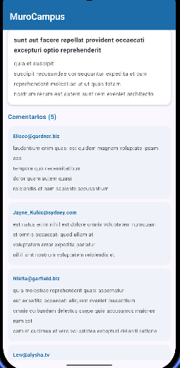
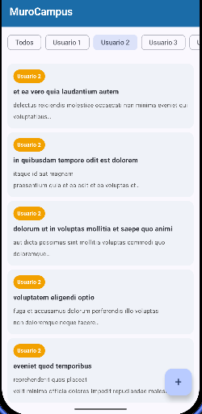
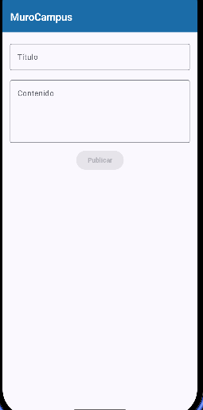
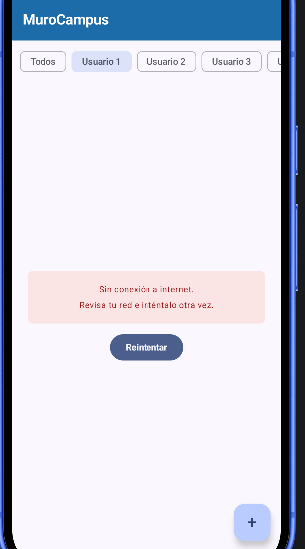

# MuroCampus

## Descripción

MuroCampus es una aplicación Android hecha con Kotlin y Jetpack Compose que consume el servicio web REST de prueba JSONPlaceholder. Permite listar publicaciones, ver el detalle de una publicación con sus comentarios, filtrar por usuario y crear una publicación nueva. También maneja los errores de red mostrando un mensaje y un botón para reintentar.

Usa Retrofit con OkHttp para las llamadas, kotlinx.serialization para convertir el JSON en `data class`, y una arquitectura MVVM con Repository.

## Estructura de paquetes

```text
com.lajara.murocampus/
├── MainActivity.kt
├── model/
│   └── Modelos.kt
├── data/
│   ├── remote/
│   │   ├── PostApi.kt
│   │   └── RetrofitClient.kt
│   └── PostRepository.kt
├── viewmodel/
│   ├── UiState.kt
│   ├── PostsViewModel.kt
│   └── PostsViewModelFactory.kt
└── ui/
    ├── Componentes.kt
    ├── PantallaLista.kt
    ├── PantallaDetalle.kt
    ├── PantallaCrear.kt
    └── theme/
```

## Arquitectura MVVM + Repository

```text
View (PantallaLista, PantallaDetalle, PantallaCrear)
  | eventos: cargar, filtrar, publicar
  | collectAsStateWithLifecycle()
  v
ViewModel (PostsViewModel) --- StateFlow<UiState> (Cargando / Exito / Error)
  | viewModelScope.launch
  v
PostRepository (interface)  <- devuelve Result<...>
  |
  v
PostRepositoryRemote (captura IOException, HttpException...)
  |
  v
PostApi (Retrofit) --- OkHttp ---> https://jsonplaceholder.typicode.com/
```

## Capturas

### Lista de publicaciones


### Detalle con comentarios


### Filtro por usuario


### Crear publicación


### Error de conexión


## Para pensar

**1. ¿Qué diferencia hay entre GET y POST? ¿Por qué crear lleva `@Body` y `porUsuario` lleva `@Query`?**

GET sirve para leer datos y no cambia nada en el servidor. POST sirve para enviar datos nuevos y crear un recurso. Crear lleva `@Body` porque la publicación viaja como JSON dentro del cuerpo de la petición. `porUsuario` lleva `@Query` porque el usuario es solo un filtro que se agrega al final de la URL (`posts?userId=2`).

**2. ¿Por qué la ruta es `"posts"` y no `"/posts"`?**

Porque una ruta que empieza con `/` reemplaza todo el camino de la URL base. Sin la barra, Retrofit une la ruta con la base y arma bien la dirección final.

**3. ¿Por qué el Repository devuelve `Result` en vez de dejar que la excepción llegue al ViewModel?**

Para que el ViewModel no tenga que conocer los errores de red ni de Retrofit. El Repository captura las excepciones y las convierte en `Result.failure`, y el ViewModel solo decide qué estado mostrar. Así la pantalla no se cae por un error inesperado.

**4. ¿Qué pasa si olvidas el permiso INTERNET? ¿Y si olvidas `ignoreUnknownKeys` y el servidor agrega un campo nuevo?**

Sin el permiso, la app compila pero nunca se conecta y siempre muestra un error de red, aunque haya internet. Sin `ignoreUnknownKeys`, la app falla con una `SerializationException` en cuanto el servidor envía un campo que el modelo no tiene.

**5. ¿Por qué la pantalla de lista usa un `when` sobre `UiState` y no un `if` con tres variables?**

Porque `UiState` es una interfaz sellada que solo puede estar en un estado a la vez: Cargando, Éxito o Error. El `when` obliga a manejar los tres casos y evita combinaciones imposibles, como estar cargando y con error al mismo tiempo.

**6. JSONPlaceholder no guarda los POST. ¿Cómo cambiaría tu app si usaras un servicio real?**

La publicación nueva aparecería al volver a cargar la lista. Además habría que enviar el usuario real en lugar de un `userId` fijo, usar autenticación (por ejemplo un token) y manejar más errores, como datos inválidos o permisos.